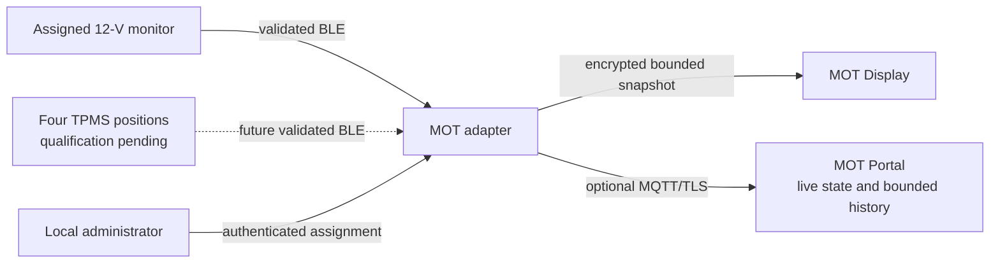

# Local vehicle sensors

> **Status:** 12-V monitor pilot path validated; TPMS integration prepared but not qualified
>
> **Audience:** Pilot user, product evaluator, installer and maintainer
>
> **Last reviewed:** 2026-10-21

MOT can extend passive CAN telemetry with locally assigned Bluetooth Low Energy
(BLE) sensors. The compatible MOT adapter remains the only component that owns
sensor assignments, validates measurements and distributes a bounded vehicle
snapshot to MOT Display and, when enabled, to the MOT Portal.

## Current scope

| Accessory | Local slots | Current status | Available information |
|---|---:|---|---|
| 12-V battery monitor | 1 | Controlled BM2/BM6-family pilot; real B.025 evidence | Current voltage, bounded minimum/maximum and voltage trend |
| Tyre-pressure sensors | 4 | Architecture and UI transport prepared; real sensors not qualified | Front-left, front-right, rear-left and rear-right pressure after qualification |

The four tyre positions are deliberately shown as **prepared**, not as an
available product feature. Current test values are simulated engineering data
used to validate transport, display and warning presentation. They must not be
interpreted as real tyre measurements.

## Assignment and trust boundary

Sensor ownership is configured only through the authenticated adapter WebUI:

1. the local administrator starts a bounded scan;
2. a discovered compatible identity is explicitly assigned to one stable slot;
3. the adapter persists the normalized identity and protocol locally;
4. normal acquisition accepts only the assigned identity and plausible data;
5. unassigning immediately invalidates that sensor's live, history and alarm state.

Cloud services and MOT Display cannot silently create or change an assignment.
The registry provides one board-battery slot and four stable wheel slots. Only
the board-battery slot is currently enabled for normal assignment.

## 12-V battery monitor

The controlled pilot path supports a locally assigned BM2/BM6-family monitor.
The adapter reads and validates the separate 12-V battery voltage over BLE. The
latest qualified voltage and a bounded trend can be shown locally and in the
authenticated portal. MOT Display can receive the current, minimum and maximum
values through the encrypted vehicle-board snapshot.

The monitor is optional and disabled until explicitly assigned. It is not a
replacement for a qualified permanent-power installation, and a single voltage
sample is not a reliable battery state-of-charge measurement. See
[Vehicle board-network power and 12-V battery monitoring](vehicle-board-power.md)
for electrical, standby and alarm qualification.

## Tyre-pressure sensors

The shared model reserves four wheel positions so a later TPMS implementation
can use the same local ownership, storage, plausibility and unassignment rules.
Before activation, a real sensor family must be qualified for:

- BLE protocol and stable identity;
- unambiguous wheel assignment;
- pressure units, ranges, freshness and plausibility;
- battery and communication-loss behaviour;
- warning thresholds and safe stale-data presentation;
- coexistence with the 12-V monitor and MOT Display.

Until this evidence exists, TPMS pairing remains disabled and the landing page,
portal and display must label the function as being prepared or in development.

## Data paths

Solid lines are active pilot paths. The dotted TPMS line is prepared architecture,
not a released sensor integration.

## Related documents

- [Local device assignment](../webui/local-devices.md)
- [MOT Display](mot-display.md)
- [System architecture](../architecture/overview.md)
- [Vehicle and 12-V display sprint](../project/sprints/DISPLAY-VEHICLE-12V-001.md)
- [Current validated status](../governance/CURRENT_STATUS.md)
