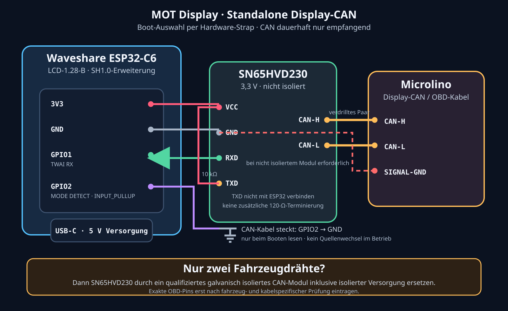

# MOT Display — Standalone Display-CAN wiring

> **Status:** Prototype accepted and frozen; not a maintained product path
>
> **Last updated:** 2026-10-14
>
> **Target:** Waveshare ESP32-C6-LCD-1.28-B with optional local Display-CAN

The MOT Display remains powered exclusively through its standard USB-C input.
It must not take permanent supply from OBD. A local CAN receiver is an optional
boot-selected data source for the emergency-instrument mode; it does not turn
the display into a vehicle-control device.

The physical prototype received Display-CAN data and rendered the emergency
instrument successfully. Useful charging power and energy would require a
second CAN input, making hardware, wiring and long-term firmware maintenance
disproportionate to this fallback. This page therefore records the accepted
prototype; future MOT Display product work continues on the BLE adapter path.

## Proposed display-side wiring

| Display expansion signal | Connection | Purpose |
|---|---|---|
| `3V3` | CAN module `VCC` and 10 kΩ TXD pull-up | Logic/transceiver supply |
| `GND` | CAN module `GND` and mode-detect strap return | Display-side reference |
| `GPIO1` | CAN module `RXD` | ESP32-C6 TWAI receive input |
| `GPIO2` | pulled to `GND` when the CAN harness is fitted | Standalone-mode detection, sampled once during boot |
| CAN module `TXD` | 10 kΩ to `3V3`; **not connected to an ESP GPIO** | Permanent recessive/read-only hardware state |

The proposed GPIO allocation uses signals exposed on the board's SH1.0 14-pin
expansion connector and avoids the LCD and IMU assignments used by the current
firmware. The exact connector pin number and cable orientation must be checked
against the Waveshare schematic and the delivered cable before assembly; wire
colour alone is not authoritative.

At boot the firmware samples `GPIO2`. Low selects local Display-CAN for the
entire runtime and BLE is not started. High selects BLE for the entire runtime
and TWAI is not started. Bus traffic is not used to choose or change the mode,
so a sleeping vehicle cannot cause an unintended BLE fallback. A source change
requires a restart.

`GPIO12` and `GPIO13` are the ESP32-C6 native USB D-/D+ pins on this board and
are explicitly excluded from the harness. `GPIO3` is reserved internally as the
unwired TWAI TX signal required by the driver; it must also remain disconnected.

## Vehicle-side boundary

CAN-H and CAN-L form one twisted pair. Do not add a 120 Ω termination to a short
diagnostic stub on the already terminated vehicle bus.

The SN65HVD230 modules used by the current MOT adapter are not galvanically
isolated. With that module the robust connection includes vehicle signal ground
in addition to CAN-H/CAN-L. A universal two-wire-only OBD connection requires a
qualified isolated CAN transceiver assembly with its isolation power boundary;
USB-C power alone must not be assumed to establish vehicle signal ground.

The currently reviewed Microlino schematic makes connector `Pin 5`, routed as
GND to VCU.01, the leading **candidate** for that CAN signal reference. `Pin 4`
appears to be a more general chassis/supply ground path and `Pin 12` a separate
logic ground associated with the PWT.01 RX/TX connection. This is not yet a pin
release: verify Pin 5 electrically on the exact vehicle/cable, and never bridge
Pins 4 and 5 through the display harness without a reviewed design.

## Acceptance before vehicle use

1. Confirm cable orientation, GPIO1/GPIO2 continuity and absence of shorts.
2. Confirm that CAN-module TXD remains disconnected from every ESP GPIO and is
   held recessive at 3.3 V.
3. Confirm that no additional 120 Ω termination is fitted.
4. Power through USB-C and verify 3.3 V at the transceiver under load.
5. Verify the chosen common-ground or isolated topology explicitly.
6. Start with a current-limited bench supply, then validate receive-only TWAI at
   500 kbit/s before the first road use.

## Sources

- [Waveshare ESP32-C6-LCD-1.28 documentation](https://docs.waveshare.com/ESP32-C6-LCD-1.28)
- [Waveshare ESP32-C6-LCD-1.28 schematic](https://github.com/waveshareteam/ESP32-C6-LCD-1.28/blob/main/hardware/schematics/ESP32-C6-LCD-1.28.pdf)
- [MOT receive-only CAN hardware design](can-receive-only-design.md)
